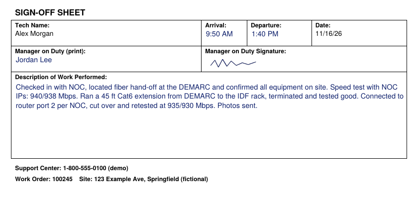
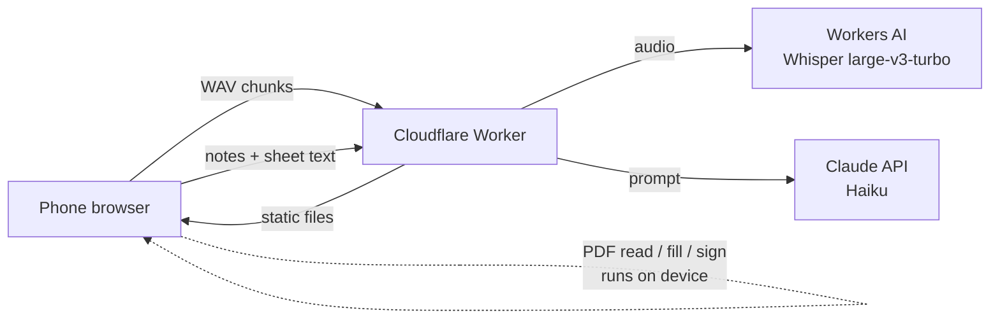

# Voice Closeout

**Talk through the job. Hand the phone to the manager. Send the signed sheet.**

Field technicians (Field Nation, WorkMarket, MSP contractors) lose 10–20 minutes per job filling in sign-off sheets and closeout notes, and payments get held when the paperwork is incomplete. Voice Closeout turns a 30-second voice note into a filled, signed sign-off PDF and ready-to-paste closeout notes, from a phone browser with nothing to install.

Built and deployed by a working field technician to solve his own daily problem.


*A demo sheet (fictional data) filled from speech: times, manager name, professional work description and on-screen signature placed into the right boxes.*

## What it does

1. **Upload the work-order PDF** the buyer sent. The app finds the sign-off boxes on its own (Arrival, Departure, Manager name, Signature, Description) and reads values already printed on the sheet (tech name, WO number, date, site).
2. **Record a voice note.** Speech is transcribed with Whisper, and Claude turns rough notes ("940 down 938 up, ran 45 feet cat 6 to the IDF") into a professional past-tense description. It flags open items and tells you what dispatch will ask for that you didn't mention.
3. **The manager signs on the phone screen.**
4. **Get one PDF:** the original sheet filled and signed, an optional Closeout Summary page, and job photos as extra pages. Share it to email or WhatsApp, and copy the closeout notes for the platform.

## Architecture



- **PDF work happens on the device** (pdf.js + pdf-lib). The server never receives the PDF, photos or signature, only the sheet's text (capped) and short audio chunks. A 50 MB PDF costs the same as a 1 MB one.
- **Generic box detection.** Labels are matched by text and position, so it works on sheets from different buyers. Value boundaries come from neighbouring labels; text shrinks to fit, and overflow continues on a summary page. Scanned sheets with no text get a summary page instead.
- **Serverless backend:** one Cloudflare Worker serves the app and two endpoints. API keys live as Worker secrets, and a beta access code protects the paid APIs.
- **Mobile-first audio:** MediaRecorder audio is decoded and resampled to 16 kHz mono WAV in the browser, then sent in 30-second chunks. This works on iPhone Safari and Android Chrome.

## Tech stack

| Layer | Tools |
|---|---|
| Frontend | Vanilla JS, HTML/CSS (no build step), pdf.js 3.11, pdf-lib 1.17, Web Audio API, MediaRecorder, Web Share API |
| Backend | Cloudflare Workers, Workers static assets, Workers AI (Whisper) |
| AI | Claude API (Haiku) with a constrained JSON prompt; no invented facts |
| DevOps | Wrangler 4, GitHub Actions deploy, secrets via `wrangler secret` |

## Project layout

```
src/worker.js        API: /api/transcribe, /api/write, access-code gate
public/index.html    Phone UI: upload, record, review, sign, share
public/core.js       PDF engine: label detection, layout, filling, summary page
samples/             Fictional demo sheet and its filled output
.github/workflows/   CI deploy to Cloudflare
```

## Run your own copy

```bash
export CLOUDFLARE_API_TOKEN=...    # Cloudflare > Account API tokens > "Edit Cloudflare Workers"
export CLOUDFLARE_ACCOUNT_ID=...
export ANTHROPIC_API_KEY=...       # platform.claude.com/settings/keys
export ACCESS_CODE=choose-a-code
bash deploy.sh
```

To have GitHub deploy on every push to `main`, add `CLOUDFLARE_API_TOKEN` and `CLOUDFLARE_ACCOUNT_ID` as repository secrets and set the repository variable `DEPLOY_ENABLED=true`.

Running cost is a fraction of a cent per closeout (Whisper on Workers AI plus one short Claude call).

## Roadmap

- [ ] Personal access codes and per-technician usage stats
- [ ] Word (.docx) sign-off sheets
- [ ] Team plan for dispatch companies: all closeouts in one dashboard
- [ ] Offline mode for basements and IDF rooms with no signal

## Author

**Yerbolat Kuanyshev**: field technician and builder. Built from my own experience closing out network installs.
